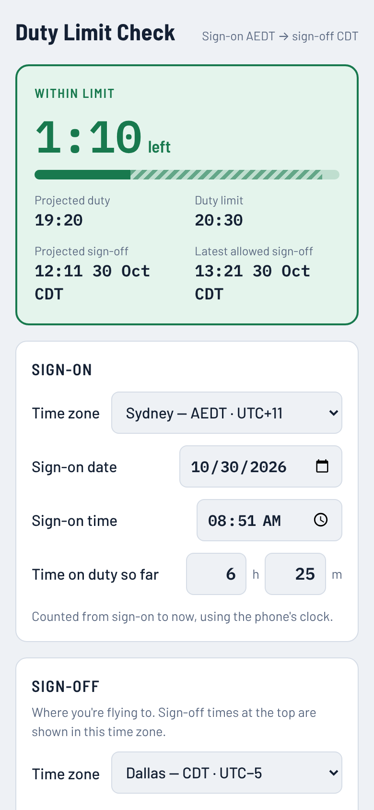

# Duty Limit Check

A phone app that tells a cabin manager, mid-trip, how much duty time the crew has left before they hit their legal limit.

**Live app:** https://anugkn-cloud.github.io/duty-limit-check/

## The problem

Cabin crew have a maximum duty period, about 20.5 hours for the crew I built this for. It starts at sign-on, and everything after that counts: delays on the ground, the flight itself, diversions, medical events on board and refuelling stops.

When a long day starts slipping, the cabin manager has to work out whether the crew will go over the limit. If they will, the manager has to bring the crew together and decide whether they stay on or get off. Today this is mental math, often done across two or three time zones, mid-flight, with no internet.

## Who it's for

Martin, a cabin manager who flies long-haul routes, including regularly into Dallas. The first version was shaped by talking through his day with him, and the later changes came from his feedback.

## What it does

- **Counts duty so far automatically** from the sign-on time, using the phone's clock. Every field can still be edited by hand.
- **Adds the time still to come:** delay, flight time, diversion, medical, gas-and-go and other duty.
- **Shows one clear status:** time left or time over, in green, amber (within an hour) or red.
- **Handles time zones:** sign-on and sign-off each have their own zone, shown as names like CDT or AEDT, not just UTC offsets. Sign-off times appear in destination local time, so there's no converting.
- **Checks a projected landing time:** enter the landing time in local destination time and see the duty at landing.
- **Has an editable limit** that defaults to 20h 30m.
- **Works offline** once it's added to the home screen, because there's no Wi-Fi when you need it most.

## Key product decisions

| Decision | Why |
| --- | --- |
| A web app, not an App Store app | One link works on iPhone and Android, with no review process. Adding it to the home screen gives app-like, offline use. |
| The clock counts time worked so far | Typing every past block of time mid-flight is slow and error-prone. Only the future needs entering. |
| Delays and medical time count towards duty | This matches how the duty period is defined: everything after sign-on counts. |
| No assumed pre- or post-flight buffers | Assumed defaults would hide time Martin didn't enter himself. |
| No accounts and no database in V1 | It only needs to calculate. Logging the crew's stay-or-leave decisions is planned for V2. |
| Time zone data comes from the phone | The built-in IANA time zone database works offline, costs nothing, and handles daylight saving changes. |

## What changed after feedback

1. **The boxes overlapped when tapped** on a phone. Fixed the spacing and focus styling.
2. **"Let me pick the time zone."** Added a picker listing every zone, with common crew destinations at the top.
3. **"I need the zone I'm flying to as well."** Added a separate sign-off section and showed zone names (CDT/CST) next to the offsets.

## What's next

- V2: record the crew's stay-or-leave decisions when the limit is close.
- Trim the time zone list to the routes Martin actually flies, if the full list gets in the way.
- Support duties with more than one flight.

## How it was built

I wrote the plan, made the product calls and ran the feedback loop with Martin. I used [Claude Code](https://claude.com/claude-code) to prototype and build it. Each change after launch went through a pull request, so the history records why each change was made.

The app is plain HTML, CSS and JavaScript with no frameworks or build step: `index.html`, a service worker (`sw.js`) for offline use, and a web app manifest. It's hosted on GitHub Pages.

## Disclaimer

This is a planning aid only. The airline's rules and rostering system are the official record.
